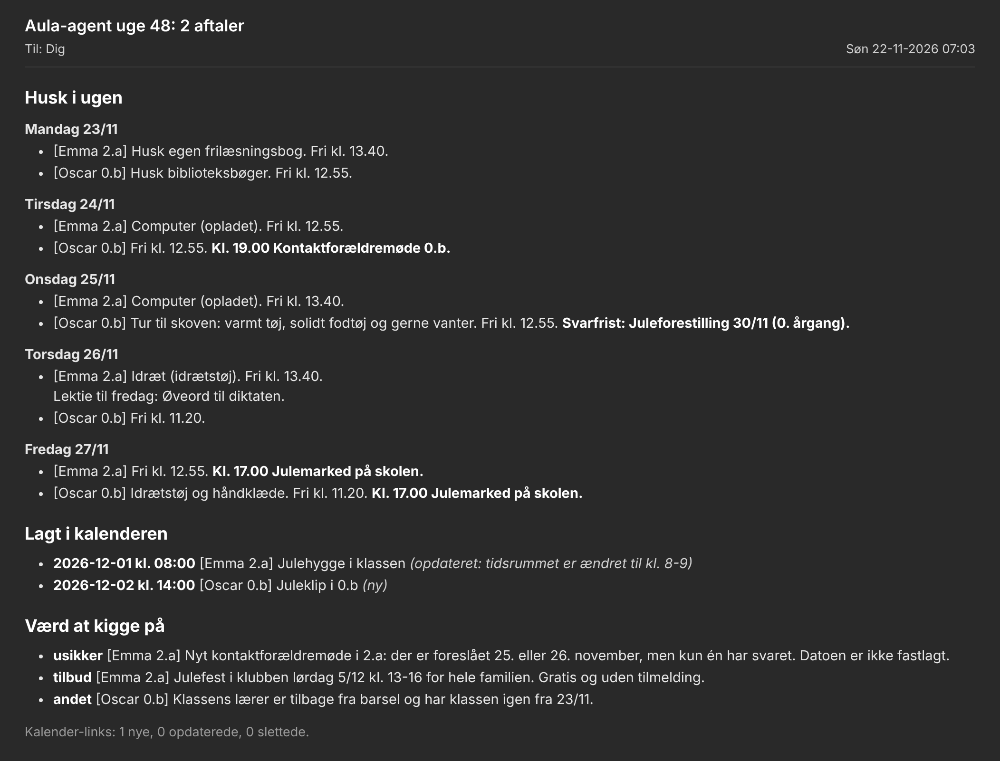
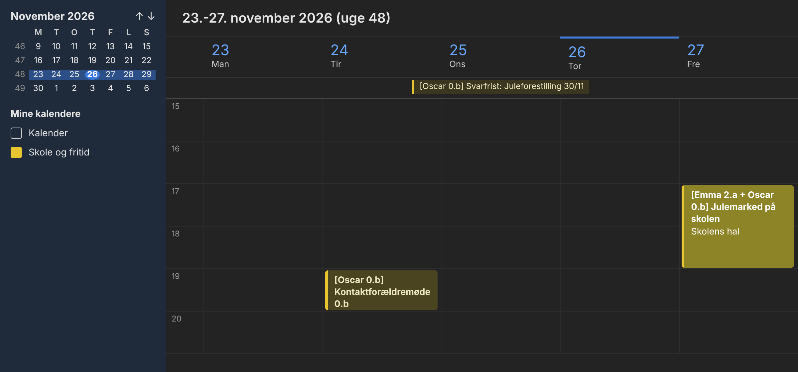

# Aula-kalenderagent

Læser Aula for dig hver uge og lægger de datoer, du som forælder skal bruge, ind i din Outlook-kalender: forældremøder, kontaktforældrearrangementer, fødselsdage, legeaftaler, svarfrister og skolens begivenheder. Hver aftale bliver mærket med barnets navn og klasse, fx `[Emma 2.a] Forældremøde`.

Hver søndag får du også en ugemail med **Husk i ugen** øverst: én linje pr. barn pr. dag med lektier, ture, idræt, ting der skal med, og hvornår barnet har fri. Under huskelisten står nye aftaler og ting, du bør kigge på selv: tilbud fra klubben, usikre datoer og dage, hvor flere børn har noget samtidig.

Eksemplerne herunder har opdigtede navne.

**Ugemailen**



**Kalenderen "Skole og fritid" i Outlook**



> Uofficielt projekt. Ikke lavet eller godkendt af Aula, KL, STIL eller Netcompany. Det bruger Aulas interne API, som kan ændre sig uden varsel.

## Privatliv kort

- Agenten kører på din egen computer. Login og indstillinger bliver hos dig og er krypteret med Windows. Intet sendes til mig, og der er ingen statistik eller sporing.
- Teksten fra opslag, beskeder, vedhæftede filer og ugeplaner sendes til den AI, du vælger (Claude eller ChatGPT), så den kan finde datoerne.
- Før noget sendes, bliver navne skiftet ud med dæknavne ("Barn 3", "Forælder 5"), også dit eget og dine børns. Det samme gælder mailadresser, telefonnumre og adresser, som nogen har skrevet i en tekst. Alt sættes ind igen på din computer bagefter.
- Agenten henter ikke kontaktoplysninger fra Aula. Det, AI'en får, handler derfor mest om hvad der skal ske og hvornår, ikke om hvem folk er.
- Det fanger ikke alt, fx navne, der ikke står på Aulas lister.
- Slå træning fra, så Aula-indholdet ikke bruges til at træne AI'en:
  - **Claude:** claude.ai > Indstillinger > Privatliv > slå "Help improve Claude" fra.
  - **ChatGPT:** chatgpt.com > Indstillinger > Datastyring > slå "Gør modellen bedre for alle" fra. Det gælder også Codex.
  - **Med API-nøgle** bruges data ikke til træning.

Detaljer: [Privatliv og sikkerhed](docs/privatliv.md).

## Det skal du have

- Windows 10 eller 11.
- En personlig Outlook-konto (@outlook.com, @hotmail.com, @live.dk). Arbejdskonti virker sjældent.
- MitID-appen og adgang til Aula som forælder.
- Claude eller ChatGPT på én af fire måder:
  - **Claude Pro eller Max (anbefalet).** Koster ikke ekstra.
  - **ChatGPT Plus eller Pro.** Koster ikke ekstra. Go og Free giver store mangler i ugemailen.
  - **Claude API-nøgle.** Omkring 6-10 kr. om måneden.
  - **OpenAI API-nøgle.** Betales pr. kørsel.
- En computer, der er tændt søndag. Sover den kl. 7, kører agenten, første gang du logger på eller låser op.

Priser og kvalitet: [Pris og valg af AI](docs/pris.md).

## Installation

1. Åbn **PowerShell**: klik på Start, skriv `PowerShell` og tryk Enter.
2. Kopiér linjen, indsæt den med højreklik, og tryk Enter:
   ```
   irm https://raw.githubusercontent.com/ai-tvang/aula-kalender-agent/main/install.ps1 | iex
   ```
3. Følg vinduet. Hav MitID-appen klar. Opsætningen tog ca. 7 minutter i vores test, plus tid til at installere Python og Claude Code eller Codex, hvis du ikke har dem.

Undervejs vælger du AI og logger ind med MitID og i Outlook. Agenten finder selv dine børn, klasser og Aula-grupper, opretter kalenderen "Skole og fritid", sætter en ugentlig kørsel op og laver den første kørsel med det samme.

Bagefter finder du alt ved at søge på **Aula-agent** i Start-menuen. Du skal ikke bruge PowerShell igen.

**Opdatering:** kør samme linje igen. Indstillinger og login bevares.

Er linjen sikker, installation uden linjen, og hvis noget går galt: [Installation i detaljer](docs/installation.md).

## Daglig brug

Du skal normalt ikke gøre noget. Genvejene i Start-menuen:

- **Aula-agent kør nu:** kør med det samme.
- **Aula-agent log ind på Aula igen:** når ugemailen siger, at Aula-login er udløbet.
- **Aula-agent log ind på Outlook igen:** det samme for Outlook.
- **Aula-agent opsætning:** skift AI, nyt skoleår eller nye klasser.
- **Aula-agent åbn mappen:** logs og indstillinger.

Går noget galt, står det øverst i ugemailen med en vejledning. Næste kørsel tager den mistede periode med.

Hvad agenten gør hver uge, indstillinger, kalender-links (fx sportsklubben), manuelle aftaler og egne regler: [Indstillinger og daglig brug](docs/indstillinger.md).

## Kendte begrænsninger

Kun testet på Windows med Outlook. AI'en kan tolke det samme lidt forskelligt fra uge til uge, og ugeplaner afhænger af skolens system. Hele listen og muligt senere arbejde: [Begrænsninger](docs/begraensninger.md).

## Feedback

Feedback er meget velkommen, især fra andre skoler, om installationen og om aftaler, der manglede eller ikke burde være kommet med. Opret et [issue](../../issues), eller skriv til mig på [LinkedIn](https://www.linkedin.com/in/thomas-christian-vang-1b625828). Fjern navne fra Aula først.

## Tak til

- [nickknissen/aula](https://github.com/nickknissen/aula) (MIT): Python-biblioteket til Aula og MitID, som agenten bygger på.
- [jesperbagger/aula-huskeliste](https://github.com/jesperbagger/aula-huskeliste): et beslægtet projekt med en daglig huskeliste på mail og Google Kalender.

## Licens

MIT. Se [LICENSE](LICENSE).
